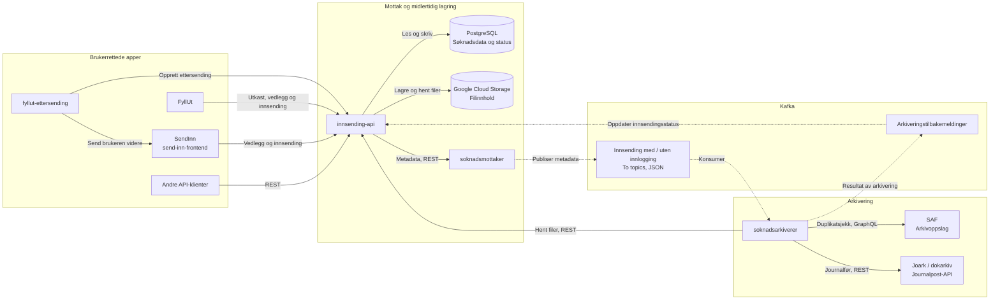
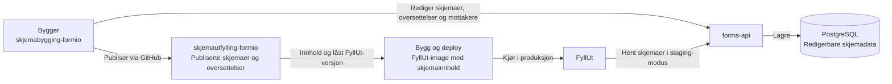
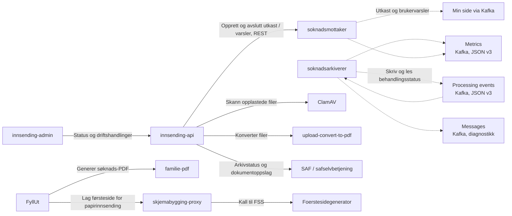

# Innsending og arkivering

FyllUt og SendInn bruker `innsending-api` til å lagre og sende inn søknader og
vedlegg. `soknadsmottaker` publiserer metadata til Kafka. `soknadsarkiverer`
henter filene fra `innsending-api`, arkiverer i Joark og melder resultatet tilbake.

Oversikten erstatter ikke [PNG-en](innsending-arkitektur.png), men retter og
utvider den ut fra lokal kode og konfigurasjon kontrollert 30. oktober 2026.
Den beskriver systemets forbindelser, ikke verifisert deploymentstatus.

## Hovedflyt for digital innsending

Heltrukne piler viser API-kall eller lesing og skriving av lagring.
Stiplede piler viser Kafka-meldinger. Pilen for filhenting peker fra den som
kaller API-et, ikke i retningen filinnholdet returneres.

- Kafka overfører metadata og filreferanser, ikke de opplastede filene.
- Innsending med og uten innlogging har hver sin kanal fra mottaker til arkiverer.
- FyllUt kan sende inn direkte. SendInn er ikke et obligatorisk mellomledd.
  SendInn brukes blant annet ved ettersending og rene dokumentinnsendinger,
  og kan fullføre eldre FyllUt-utkast.
- SAF-oppslaget hjelper arkivereren med å unngå duplikate journalposter.
  Arkivereren følger behandlingsstatus og prøver på nytt ved forbigående feil.

## Skjemabygging og publisering

Skjemapublisering er en egen flyt og sender ikke inn brukerdata.
Bygger og FyllUt har kode i `skjemabygging-formio`.
`skjemautfylling-formio` er et repo med publisert innhold, ikke en ekstra API-tjeneste.

I produksjon leser FyllUt publisert innhold fra imaget. Pilen til `forms-api`
gjelder staging-modus, ikke produksjonens vanlige skjemaoppslag.
SendInn og `fyllut-ettersending` henter også skjemainformasjon fra FyllUt.

## Støtteflyter og drift

Disse forbindelsene er skilt ut for å holde hovedflyten lesbar.
Stiplede piler er Kafka-meldinger også her. Min side er vist som mottakende
funksjon; diagrammet deler ikke opp tjenestene som konsumerer meldingene.

- Utkast og oppgaver i PNG-en er meldinger til Min side, ikke søknadsdatabaser.
  Mottakeren håndterer også beskjeder og avslutning av varsler.
- `Processing events` støtter behandlingsstatus og gjenopptakelse i arkivereren.
  `Metrics` er måledata. `Messages` inneholder diagnostikk og kopier av
  tilbakemeldinger, men er ikke topicet `innsending-api` konsumerer for arkivstatus.
- Nye innsendingsmeldinger, behandlingshendelser og Kafka-metrikker bruker JSON.
  Historiske Avro-data, interne Avro-typer og gjenlesing finnes fortsatt.
  `soknadarkiv-schema` er et delt skjemabibliotek, ikke en kjørende app.
- FyllUt genererer søknads-PDF via `familie-pdf`. Filkonvertering og
  PDF-sammenslåing i `innsending-api` er separate operasjoner.
- Person- og forutfyllingsoppslag, blant annet PDL, Arena, kodeverk og
  kontoregister, er utelatt fra diagrammene. De støtter utfylling, ikke selve
  arkiveringsoverleveringen. Innlogging, tokenutveksling og observerbarhet er
  også utelatt; pilene beskriver ikke tilgangsregler.

## Rettelser fra PNG-en

| PNG-en | Presisering i denne oversikten |
| --- | --- |
| «Innsending-api» og «Soknads Admin» | Bruker reponavnene `innsending-api` og `innsending-admin`. |
| Én «Db» | Skiller PostgreSQL for søknadsdata fra GCS for filinnhold. |
| «submission» mellom API og mottaker | Dette er et REST-kall, ikke et ekstra Kafka-topic. |
| «Submission» og «NoLogin-Submission» | Beholder skillet som to Kafka-kanaler, samlet i én boks. |
| «Messages» til API-et | Arkivstatus går via et eget topic for arkiveringstilbakemeldinger. |
| «Innsendte» | Ingen separat komponent med dette navnet er identifisert i den kontrollerte flyten. Innsendingsstatus vises som data i API-et og tilbakemeldinger fra arkivereren. |
| «JP-API», «SAF» og «Joark» | Viser arkivererens to integrasjoner: oppslag via SAF og journalføring via Joarks journalpost-API. Interne forbindelser i arkivet er ikke kartlagt. |
| Umerkede grønne ovaler | Erstattet med navngitte og merkede forbindelser. |
| Manglende apper og støttetjenester | Lagt til ettersending, skjemapublisering, filbehandling og Min side. |

## Kilder og begrensninger

Kontrollen bruker lokal kildekode, ikke bare eldre README-er og illustrasjoner.
Lenkene peker til filene på `main` og kan endre seg etter kontrollen.

| Del | Kilder |
| --- | --- |
| Lagring, tjenester og arkiveringstilbakemeldinger | [innsending-api: application.yml](https://github.com/navikt/innsending-api/blob/main/innsender/src/main/resources/application.yml), [CloudStorageClient.kt](https://github.com/navikt/innsending-api/blob/main/innsender/src/main/kotlin/no/nav/soknad/innsending/config/CloudStorageClient.kt), [produksjonskonfigurasjon](https://github.com/navikt/innsending-api/blob/main/.nais/prod-gcp.json) |
| Innsendingsmetadata som JSON | [soknadsmottaker: InnsendingService.kt](https://github.com/navikt/soknadsmottaker/blob/main/mottaker/src/main/kotlin/no/nav/soknad/arkivering/soknadsmottaker/service/InnsendingService.kt) |
| Arkivering, Kafka-status og metrikker | [soknadsarkiverer: ArchiverService.kt](https://github.com/navikt/soknadsarkiverer/blob/main/arkiverer/src/main/kotlin/no/nav/soknad/arkivering/soknadsarkiverer/service/ArchiverService.kt), [KafkaPublisher.kt](https://github.com/navikt/soknadsarkiverer/blob/main/arkiverer/src/main/kotlin/no/nav/soknad/arkivering/soknadsarkiverer/kafka/KafkaPublisher.kt), [application.yml](https://github.com/navikt/soknadsarkiverer/blob/main/arkiverer/src/main/resources/application.yml) |
| Utkast og brukervarsler | [soknadsmottaker: NotificationService.kt](https://github.com/navikt/soknadsmottaker/blob/main/mottaker/src/main/kotlin/no/nav/soknad/arkivering/soknadsmottaker/service/NotificationService.kt), [innsending-api: BrukernotifikasjonPublisher.kt](https://github.com/navikt/innsending-api/blob/main/innsender/src/main/kotlin/no/nav/soknad/innsending/brukernotifikasjon/BrukernotifikasjonPublisher.kt) |
| Direkte innsending fra FyllUt og søknads-PDF | [FyllUt: common.ts](https://github.com/navikt/skjemabygging-formio/blob/main/packages/fyllut-backend/src/routers/api/send-inn/application/common.ts) |
| Ettersending og SendInn | [fyllut-ettersending: apiService.ts](https://github.com/navikt/fyllut-ettersending/blob/main/src/api/apiService.ts), [SendInn: API-proxy](https://github.com/navikt/send-inn-frontend/blob/main/pages/api/backend/%5B%5B...all%5D%5D.ts) |
| Skjemapublisering | [Bygger: Backend.ts](https://github.com/navikt/skjemabygging-formio/blob/main/packages/bygger-backend/src/Backend.ts), [FyllUt: produksjonskonfigurasjon](https://github.com/navikt/skjemabygging-formio/blob/main/.nais/fyllut/prod.yaml), [publisert FyllUt: Dockerfile](https://github.com/navikt/skjemautfylling-formio/blob/main/Dockerfile) |

Repoene `innsending-admin`, `forms-api`, `skjemabygging-proxy` og
`upload-convert-to-pdf` var ikke tilgjengelige for direkte kodekontroll.
Forbindelsene deres bygger på tilgjengelige klientkall, konfigurasjon og den
eksisterende [systemguiden](flow.html). Admin-flyten og proxyens videre kall
til Foerstesidegenerator er dermed dokumentert, men ikke kodeverifisert på begge
sider. PNG-ens direkte admin-forbindelse til arkivereren er ikke bekreftet som
en aktiv kallflyt og er ikke tatt med.

`arkiv-mock` og dette repoet (`archiving-infrastructure`) er testverktøy, ikke
produksjonsledd. I de lokale systemtestene erstatter `arkiv-mock` Joark og SAF.
Se [docker-compose.yml](../docker-compose.yml) og [kjøreveiledningen](../README.md).
