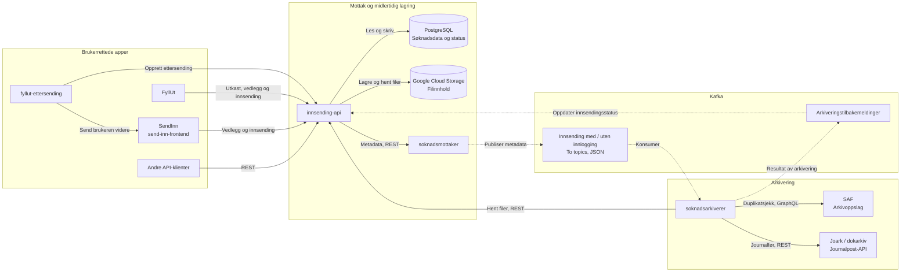
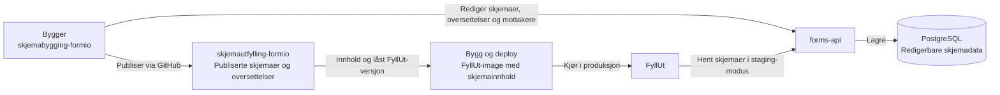
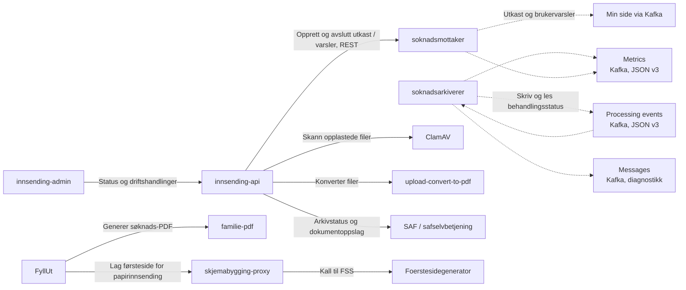

# Innsending og arkivering

FyllUt og SendInn bruker `innsending-api` til å lagre og sende inn søknader og
vedlegg. `soknadsmottaker` publiserer metadata til Kafka. `soknadsarkiverer`
henter filene fra `innsending-api`, arkiverer i Joark og melder resultatet tilbake.

Oversikten bygger på lokal kode og konfigurasjon kontrollert 30. oktober 2026.
Den beskriver systemets forbindelser, ikke verifisert deploymentstatus.

## Hovedflyt for digital innsending

Heltrukne piler viser API-kall eller lesing og skriving av lagring.
Stiplede piler viser Kafka-meldinger. Pilen for filhenting peker fra den som
kaller API-et, ikke i retningen filinnholdet returneres.

- Kafka overfører metadata og filreferanser, ikke de opplastede filene.
- Innsending med og uten innlogging har hver sin kanal fra mottaker til arkiverer.
- FyllUt kan sende inn direkte. SendInn er ikke et obligatorisk mellomledd.
  SendInn brukes blant annet ved ettersending og rene dokumentinnsendinger,
  og kan fullføre eldre FyllUt-utkast.
- SAF-oppslaget hjelper arkivereren med å unngå duplikate journalposter.
  Arkivereren følger behandlingsstatus og prøver på nytt ved forbigående feil.

## Skjemabygging og publisering

Skjemapublisering er en egen flyt og sender ikke inn brukerdata.
Bygger og FyllUt har kode i `skjemabygging-formio`.
`skjemautfylling-formio` er et repo med publisert innhold, ikke en ekstra API-tjeneste.

I produksjon leser FyllUt publisert innhold fra imaget. Pilen til `forms-api`
gjelder staging-modus, ikke produksjonens vanlige skjemaoppslag.
SendInn og `fyllut-ettersending` henter også skjemainformasjon fra FyllUt.

## Støtteflyter og drift

Disse forbindelsene er skilt ut for å holde hovedflyten lesbar.
Stiplede piler er Kafka-meldinger også her. Min side er vist som mottakende
funksjon; diagrammet deler ikke opp tjenestene som konsumerer meldingene.

- Utkast og oppgaver er meldinger til Min side, ikke søknadsdatabaser.
  Mottakeren håndterer også beskjeder og avslutning av varsler.
- `Processing events` støtter behandlingsstatus og gjenopptakelse i arkivereren.
  `Metrics` er måledata. `Messages` inneholder diagnostikk og kopier av
  tilbakemeldinger, men er ikke topicet `innsending-api` konsumerer for arkivstatus.
- Nye innsendingsmeldinger, behandlingshendelser og Kafka-metrikker bruker JSON.
  Historiske Avro-data, interne Avro-typer og gjenlesing finnes fortsatt.
  `soknadarkiv-schema` er et delt skjemabibliotek, ikke en kjørende app.
- FyllUt genererer søknads-PDF via `familie-pdf`. Filkonvertering og
  PDF-sammenslåing i `innsending-api` er separate operasjoner.
- Person- og forutfyllingsoppslag, blant annet PDL, Arena, kodeverk og
  kontoregister, er utelatt fra diagrammene. De støtter utfylling, ikke selve
  arkiveringsoverleveringen. Innlogging, tokenutveksling og observerbarhet er
  også utelatt; pilene beskriver ikke tilgangsregler.

## Kilder og begrensninger

Kontrollen bruker lokal kildekode, ikke bare eldre README-er og illustrasjoner.

| Del | Kilderepoer |
| --- | --- |
| Lagring, tjenester og arkiveringstilbakemeldinger | `innsending-api` |
| Innsendingsmetadata som JSON | `soknadsmottaker` |
| Arkivering, Kafka-status og metrikker | `soknadsarkiverer` |
| Utkast og brukervarsler | `soknadsmottaker`, `innsending-api` |
| Direkte innsending fra FyllUt og søknads-PDF | `skjemabygging-formio` |
| Ettersending og SendInn | `fyllut-ettersending`, `send-inn-frontend` |
| Skjemapublisering | `skjemabygging-formio`, `skjemautfylling-formio` |

Repoene `innsending-admin`, `forms-api`, `skjemabygging-proxy` og
`upload-convert-to-pdf` var ikke tilgjengelige for direkte kodekontroll.
Forbindelsene deres bygger på tilgjengelige klientkall, konfigurasjon og den
eksisterende systemguiden. Admin-flyten og proxyens videre kall
til Foerstesidegenerator er dermed dokumentert, men ikke kodeverifisert på begge
sider. En direkte admin-forbindelse til arkivereren er ikke bekreftet som
en aktiv kallflyt og er ikke tatt med.

`arkiv-mock` og dette repoet (`archiving-infrastructure`) er testverktøy, ikke
produksjonsledd. I de lokale systemtestene erstatter `arkiv-mock` Joark og SAF.
README-en beskriver hvordan du kjører testene lokalt.
